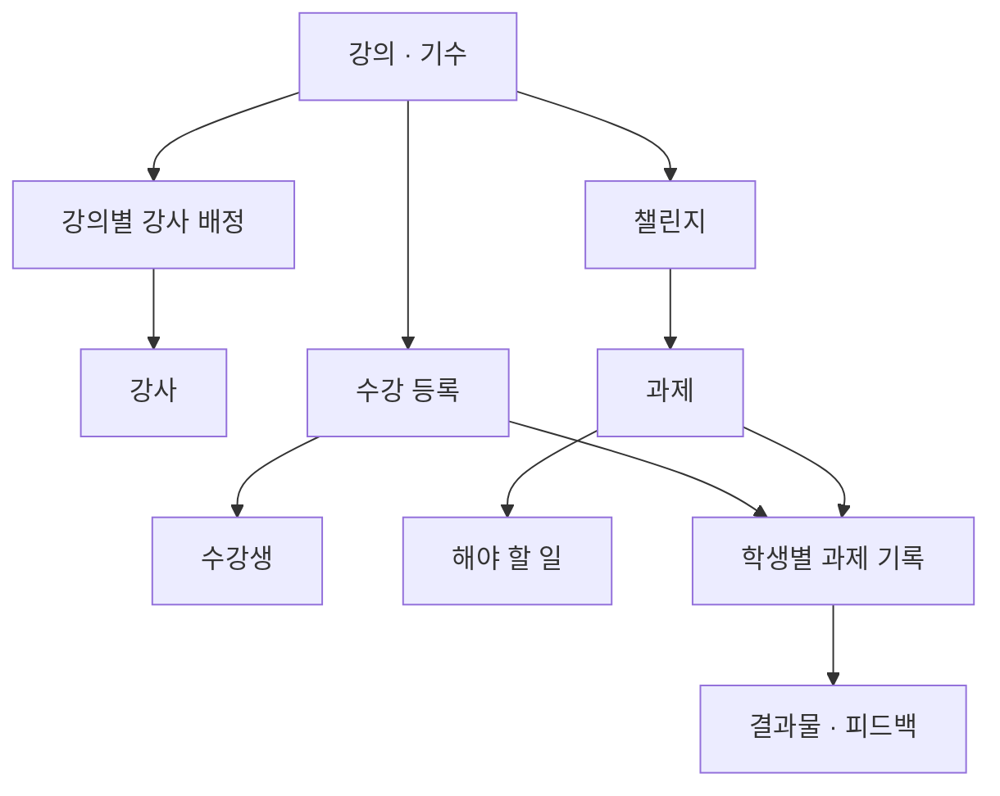

# 비즈업클래스 유료 수강생·챌린지 관리 서비스 PRD

> **정책 변경 (2026-11):** 수강생을 전체 시스템이 공유하지 않고 강의마다 따로 둡니다. 아래의 "전화번호 기준 전역 중복 방지·학생 고유번호 하나 유지·기존 학생 연결" 관련 요구사항은 이 변경으로 대체되었습니다. 현재 동작은 README의 "구현 요약"을 따릅니다.

- 문서 버전: 1.0
- 작성일: 2026-11-19
- 날짜·시간 기준: 대한민국 표준시 `Asia/Seoul`
- 문서 상태: 사용자 요구사항 및 12개 운영 결정 반영 완료
- 서비스명: 비즈업클래스 수강생 챌린지 관리 — 가칭
- 대상: 관리자, 배정 강사, 유료 수강생
- 산출 범위: 제품 요구사항, 화면, 권한, 논리 데이터 모델, 주요 API, 운영 정책, 검수 기준
- 이 문서는 구현·배포 결과물이 아니라 개발과 검수의 기준 문서다.

## 1. 제품 목적과 문서 적용 원칙

### 1.1 제품 목적

유료 수강생 명단과 강사 배정, 챌린지 과제, 학생별 실행 기록을 **강의·기수 단위**로 통합 관리한다. 관리자는 전체 강의를 확인하고, 강사는 담당 강의의 실행 과정을 관리하며, 수강생은 자신의 과제 수행과 결과물 제출, 피드백 확인을 한곳에서 처리한다.

핵심 운영 흐름은 다음과 같다.

1. 관리자가 강의·기수를 만들고 강사를 배정한다.
2. 관리자가 유료 수강생 명단을 업로드하여 강의에 연결한다.
3. 강사가 챌린지와 공통 과제, 해야 할 일 목록을 작성한다.
4. 수강생이 할 일을 체크하고 필요한 결과물을 제출한다.
5. 시스템이 완료 조건을 계산하고, 강사와 관리자가 진행 상황을 확인한다.
6. 강사가 학생별 과제에 피드백을 남기면 해당 학생이 확인한다.

### 1.2 확정 요구사항과 설계 기본값

- **사용자 확정:** 최초 15개 요구사항과 아래 12개 질문의 답변이다. 기능 구현 시 우선 적용한다.
- **설계 기본값:** 별도로 묻지 않은 세부 사항을 개발할 수 있도록 정한 기준이다. 파일 용량, 세션 시간, 목록 표시 방식 등이 해당한다.
- **구현 제안:** 테이블명, API 경로, 내부 ID 형식 등이다. 같은 기능·권한·무결성을 만족하면 개발 과정에서 변경할 수 있다.
- 인증 공급자, 호스팅 업체, 구체적인 프레임워크는 사용자가 지정하지 않았다. 특정 제품의 도입을 확정 사항으로 취급하지 않는다.
- 별도로 구분하지 않은 세부 운영 정책은 본 문서의 설계 기본값이다. 추가 사용자 답변을 기다리는 기능 결정은 없다.

### 1.3 사용자와 확정한 운영 결정

| 번호 | 주제 | 확정 내용 |
|---|---|---|
| D01 | 강의·기수 | 같은 내용의 강의라도 기수마다 별도 강의로 만들고 고유번호를 부여 |
| D02 | 챌린지 항목 | 과제 안의 해야 할 일 목록, 즉 체크리스트 |
| D03 | 수강생 로그인 | 이름을 아이디, 전화번호를 비밀번호로 사용. 변경 불가. 추가 인증 없음 |
| D04 | 챌린지 개수 | 한 강의 안에 여러 챌린지 생성 가능. 챌린지마다 제목·기간·과제 설정 |
| D05 | 과제 배정 | 해당 강의의 모든 수강생에게 같은 과제를 공통 배정 |
| D06 | 결과물 제출 | 수강생 파일·링크 제출 제공. 강사가 과제별로 필수·선택 설정 |
| D07 | 명단 등록 | 관리자만 업로드·등록. 강사는 배정 강의의 명단 조회 |
| D08 | 종료 후 처리 | 강사가 챌린지별로 종료 후 체크·제출·수정 허용 여부 설정 |
| D09 | 운영자 로그인 | 강사·관리자는 이메일과 별도 비밀번호로 로그인 |
| D10 | 열람 기간 | 관리자가 수강 등록을 비활성화하기 전까지 강의 자료와 기록 열람 |
| D11 | 진행 중 과제 수정 | 기존 과제는 유지하고 복사하여 새 과제로 추가 |
| D12 | 피드백 | 강사가 학생별 과제에 피드백을 남기고 해당 학생이 확인 |

## 2. 초기 버전 범위와 성공 기준

### 2.1 포함 기능

| 영역 | 초기 버전 필수 기능 |
|---|---|
| 계정 | 관리자·강사 계정 관리, 수강생 자동 등록, 역할별 로그인·로그아웃 |
| 강의 | 기수별 강의 등록, 고유번호, 여러 강사 배정, 목록 검색·필터 |
| 수강생 | 전화번호 기준 전역 중복 방지, 다중 강의 수강, Excel·CSV 업로드 |
| 챌린지 | 강의별 여러 챌린지, 기간, 종료 후 수정 허용 설정 |
| 과제 | 제목·설명·해야 할 일, 강사 자료, 제출 필수·선택, 초안·공개, 복사 |
| 수행 | 학생별 체크, 파일·링크 결과물, 자동 완료, 저장 상태 표시 |
| 피드백 | 학생별 과제 피드백 작성·조회·읽음 표시 |
| 현황 | 관리자 전체 대시보드, 강의별·챌린지별·학생별 진행률 |
| 운영 | 등록 비활성화·재활성화, 주요 변경 이력, 오류 안내 |

### 2.2 초기 범위에 포함하지 않는 기능

결제·환불 실행, 판매 플랫폼 자동 연동, 개별 학생 과제 배정, 문자·카카오톡·이메일 알림 캠페인, 학생 간 게시판·제출물 공유, 학생의 피드백 답글, 출석·동영상 재생 관리, 자동 채점·강사 승인, 포인트·순위·수료증은 별도 확장 범위로 둔다.

명단 업로드는 관리자가 확인한 유료 수강생을 등록하는 기능이다. 업로드 자체가 결제 사실을 외부 시스템과 대조하거나 환불을 처리하지는 않는다.

### 2.3 성공 기준

- 동일 전화번호를 여러 강의에 등록해도 수강생 고유번호는 하나로 유지된다.
- 모든 공개 과제는 해당 강의의 전체 수강생에게 적용되며, 나중에 등록된 학생도 확인할 수 있다.
- 과제 완료 상태, 학생별 진행률, 관리자·강사 집계가 같은 원천 데이터를 사용한다.
- 다른 강의나 다른 학생의 정보에 접근할 수 없다.
- 진행이 시작된 과제의 완료 조건과 학생 기록이 후속 편집·복사 때문에 바뀌지 않는다.
- 수강생은 휴대전화 화면에서 로그인, 체크, 사진·파일 제출, 링크 입력, 피드백 확인을 완료할 수 있다.

## 3. 사용자 역할과 권한

### 3.1 역할

- **관리자:** 전체 강의, 강사, 수강생, 챌린지, 진행 현황을 관리한다.
- **강사:** 현재 배정된 강의에서 명단을 확인하고 챌린지·과제·자료·피드백을 관리한다.
- **수강생:** 본인의 활성 수강 등록에 속한 강의와 본인의 수행 기록만 조회·수정한다.

관리자와 강사의 역할은 운영자 계정에 부여한다. 한 운영자가 두 역할을 겸할 수 있다. 강사 역할에는 별도의 강사 고유번호가 연결된다.

### 3.2 권한표

| 기능 | 관리자 | 강사 | 수강생 |
|---|---|---|---|
| 강의 생성·기수 관리·보관 | 전체 | 불가 | 불가 |
| 강사 계정 발급·비활성화·배정 | 전체 | 본인 계정 정보 조회 | 불가 |
| 명단 업로드·학생 등록·정보 정정 | 전체 | 불가 | 불가 |
| 수강 등록 비활성화·재활성화 | 전체 | 불가 | 불가 |
| 수강생 명단 조회 | 전체 | 배정 강의 | 본인 정보만 |
| 학생 로그인 전화번호 확인 | 전체 | 배정 강의의 활성 수강생 | 본인 정보만 |
| 다른 강의 수강 이력 조회 | 전체 | 자신이 배정된 강의에 한정 | 본인의 활성 등록 강의 |
| 챌린지·과제·강사 자료 관리 | 전체 | 배정 강의 | 조회만 |
| 과제 복사 | 모든 강의 간 | 읽기·편집 권한이 있는 강의 간 | 불가 |
| 학생 체크·제출물 조회 | 전체 | 배정 강의 | 본인만 |
| 학생 체크·제출·삭제 실행 | 불가 | 불가 | 본인만, 허용 기간 내 |
| 학생별 피드백 작성 | 전체 | 배정 강의 | 불가 |
| 피드백 조회 | 전체 | 배정 강의 | 본인에게 작성된 내용만 |
| 진행률 대시보드 | 전체 | 배정 강의 | 본인 진행률만 |
| 주요 관리 이력 조회 | 전체 | 배정 강의의 과제·피드백 관련 이력 | 본인 수행·피드백 상태 |

관리자·강사가 학생 대신 완료 처리하는 기능은 포함하지 않는다. 초기 버전에서 학생별 과제 제외·면제·개별 추가 배정도 제공하지 않는다.

### 3.3 접근권한 적용 원칙

역할만 확인하지 않고 **요청한 강의, 현재 배정·수강 등록, 대상 학생의 소유 관계**를 서버에서 함께 확인한다. URL이나 요청의 고유번호를 바꾸어도 범위 밖 정보에 접근할 수 없어야 한다. 파일 다운로드와 복사 원본 조회에도 같은 규칙을 적용한다. [R3]

- 강사 배정을 해제하면 해당 강의 권한만 회수한다.
- 학생의 특정 수강 등록을 비활성화하면 그 강의 접근만 중단한다.
- 계정 전체를 비활성화하면 모든 접근과 세션을 중단한다.
- 로그인 시점에 저장한 과거 강의 목록만으로 권한을 판단하지 않는다.
- 강사는 자신이 맡지 않은 강의의 존재·강사·수강 이력을 학생 상세 화면에서 확인할 수 없다.

## 4. 핵심 데이터 개념과 고유번호

### 4.1 강의 중심 구조



- 한 강의에 여러 강사를 배정할 수 있고, 한 강사는 여러 강의에 배정될 수 있다.
- 한 수강생은 여러 강의에 연결될 수 있다.
- 같은 강의의 1기와 2기는 서로 다른 강의다.
- 과제 수행 기록은 학생 자체가 아니라 **수강 등록 + 과제**에 속한다.
- 공통 과제의 대상은 강의의 수강 등록으로 결정한다. 개별 배정 명단을 별도로 관리하지 않는다.

### 4.2 고유번호 정책

| 대상 | 내부 고유 ID | 화면 표시번호 예시 | 정책 |
|---|---|---|---|
| 강의 | `course_id` | `CRS-000001` | 기수별 신규 발급 |
| 강사 | `instructor_id` | `INS-000001` | 담당 강의가 늘어나도 유지 |
| 수강생 | `student_id` | `STU-000001` | 정규화 전화번호 하나당 하나 |
| 수강 등록 | `enrollment_id` | 내부 관리용 | 강의·수강생 조합당 하나 |
| 챌린지·과제·할 일 | 각각 별도 ID | 필요 시 상세 화면 표시 | 복사 시 새 ID 발급 |

내부 ID는 UUID 등 충돌 방지 식별자를 사용한다. 표시번호는 사람이 검색·문의에 사용할 값이며, 전화번호를 포함하지 않는다. 표시번호와 내부 ID는 생성 후 변경·재사용하지 않는다.

학생 전화번호는 중복 판정 기준이다. **전화번호 자체를 모든 테이블의 연결키로 사용하지 않는다.** 전화번호 정정이 필요한 경우에도 학생 고유번호와 수강·진행 이력은 유지한다.

### 4.3 전화번호와 이름 정규화

- 초기 지원은 국내 휴대전화 번호를 기준으로 한다.
- 공백·하이픈·괄호를 제거하고, 유효한 `+82` 표기는 국내 앞자리 `0` 형식으로 통일한다.
- 대표 예: `010-1234-5678`, `010 1234 5678`, `+82 10 1234 5678`은 `01012345678`로 취급한다.
- 업로드, 개별 등록, 로그인, 검색에 동일한 전화번호 정규화 규칙을 사용한다.
- 길이·접두어가 유효하지 않거나 Excel에서 앞자리 0이 사라진 숫자는 자동으로 추측해 확정하지 않는다. 오류 행으로 보여주고 관리자가 수정한다.
- 이름은 앞뒤 공백 제거, 유니코드 정규화, 연속 공백 정리를 적용한다. 원래 이름도 표시용으로 보관할 수 있다.
- 이름의 중복은 허용한다. 이름만 같다고 학생을 병합하지 않는다.
- 한 번호를 두 사람이 공유하는 명단은 두 학생으로 만들지 않고 충돌로 표시한다.

## 5. 로그인과 계정 관리

### 5.1 수강생 로그인 — FR-AUTH-01

| 항목 | 요구사항 |
|---|---|
| 아이디 입력 | 등록된 이름 |
| 비밀번호 입력 | 등록된 전화번호 |
| 입력 예시 안내 | 전화번호는 숫자만 입력하도록 안내하되 하이픈·공백 표기도 정규화 |
| 가입 방식 | 관리자의 명단 등록으로 계정 생성. 공개 회원가입 없음 |
| 추가 인증 | 문자 인증, OTP, 이메일 인증 없음 |
| 본인 변경 | 이름·전화번호·비밀번호 변경 기능 없음 |
| 실패 안내 | 존재 여부를 구분하지 않는 동일한 오류 문구 |
| 등록 강의 없음 | 로그인 후 “현재 이용 가능한 강의가 없습니다” 표시 |
| 로그인 성공 | 본인의 활성 등록 강의 목록으로 이동 |

서버는 정규화한 전화번호로 학생을 조회하고 등록 이름과 인증용 비밀번호를 검증한다. 동명이인이 있어도 전화번호로 구분한다. 화면의 아이디는 이름으로 유지한다.

학생 비밀번호는 전화번호에서 파생되는 고정값이다. 별도 비밀번호를 임의로 설정하는 기능은 제공하지 않는다. 관리자가 입력 오류를 정정하면 같은 학생 ID를 유지하고 새 전화번호와 비밀번호를 함께 반영하며 기존 세션을 취소한다.

### 5.2 강사·관리자 로그인 — FR-AUTH-02

- 이메일과 별도 비밀번호로 로그인한다.
- 관리자가 강사 계정을 발급하고 강의에 배정한다. 로그인 권한이 없는 강사를 단순 연락처만 등록한 상태와 혼동하지 않도록 계정 상태를 표시한다.
- 기본 발급 흐름은 관리자 등록 → 계정 설정 링크 발급 → 강사가 비밀번호 설정 → 계정 활성화다.
- 이메일 전달 연동이 없으면 관리자가 설정 링크를 복사해 전달할 수 있다. 설정 링크는 기본 24시간 유효한 일회용 링크로 발급하고 만료·사용 후에는 재사용할 수 없다.
- 설정·재설정 링크는 대상 운영자 계정에 연결한다. 재발급하면 이전 미사용 링크도 무효화한다. 비밀번호 변경·재설정이 성공하면 기존 세션을 취소하고 새 정보로 로그인하게 한다.
- 운영자는 자신의 비밀번호를 변경하거나 재설정할 수 있다. 수강생의 변경 불가 정책은 운영자 계정에 적용하지 않는다.
- 관리자·강사 비밀번호를 다른 사용자가 조회하는 기능은 제공하지 않는다.
- 최초 관리자 계정은 배포 시 별도 초기화 절차로 만든다. 외부 공개 관리자 가입 기능은 없다.
- 마지막 활성 관리자를 비활성화하거나 관리자 권한을 모두 제거할 수 없다.

### 5.3 강사의 학생 로그인 정보 확인 — FR-AUTH-03

강사는 담당 강의의 학생 상세에서 다음을 확인한다.

| 표시 항목 | 내용 |
|---|---|
| 수강생 번호 | 학생 고유 표시번호 |
| 로그인 아이디 | 등록 이름 |
| 로그인 비밀번호 | 등록 전화번호 |
| 기본 표시 | 전화번호 일부 마스킹 |
| 조회 동작 | “로그인 정보 확인”을 누르면 전체 전화번호 표시 |
| 기록 | 조회한 강사, 학생, 강의, 시각을 기록 |

조회 대상은 해당 강의의 활성 수강생으로 제한한다. 비활성 수강 이력은 강사가 읽을 수 있으나 전체 로그인 전화번호 재노출은 제한한다. 관리자는 필요에 따라 전체 학생 정보를 조회한다.

강사용 목록·검색·상세 API도 기본적으로 마스킹된 전화번호만 반환한다. 전체 전화번호 반환은 이 절의 권한 검사와 조회 이력 정책을 공통 적용하며, 비활성 수강생의 번호를 다른 API에서 우회 노출하지 않는다. 전화번호 검색은 담당 강의 범위에서 서버가 수행한다.

인증용 비밀번호는 전용 해시로 보관하고, 강사가 보는 값은 별도 평문 비밀번호 필드가 아니라 **등록된 업무용 전화번호**다. 강사·관리자 비밀번호를 복호화해 보여주는 설계를 사용하지 않는다. [R1]

**확정된 인증 정책의 제약:** 학생의 이름과 전화번호를 아는 사람은 로그인할 수 있다. 해시 저장이나 접속 제한으로 이 특성이 없어지는 것은 아니다. 사용자가 추가 인증 없이 운영하기로 선택했으며, 본 문서는 해당 조건을 유지한다.

### 5.4 세션 기본값

- 서버에서 취소 가능한 세션을 사용한다. 로그아웃, 계정 비활성화, 로그인 정보 정정 시 해당 범위의 세션을 무효화한다. [R4]
- 기본 제안: 학생은 최대 7일·미사용 24시간, 강사·관리자는 최대 12시간·미사용 2시간. 더 짧은 만료 조건이 먼저 적용된다.
- 세션 시간은 운영 설정값으로 관리한다. 수강생에게 추가 인증을 요구하는 방식으로 변경하지 않는다.
- 모든 변경 요청은 현재 권한을 다시 확인한다. 특정 수강 등록 해제는 다른 강의의 세션 이용을 막지 않는다.
- 중복 로그인 기기 수 제한은 초기 범위에 포함하지 않는다.

## 6. 강의와 강사 관리

### 6.1 강의 등록 — FR-COURSE-01

| 필드 | 필수 | 설명 |
|---|---|---|
| 강의 고유번호 | 자동 | 수정 불가 |
| 강의명 | 필수 | 실제 운영 상품 또는 교육명 |
| 기수명 | 필수 | 예: 1기, 2027년 1월반 |
| 소개 | 선택 | 수강생에게 보이는 간단 안내 |
| 강의 시작일·종료일 | 선택 | 표시·검색용 일정 |
| 운영 상태 | 필수 | 준비 중 / 진행 중 / 종료 / 보관 |
| 배정 강사 | 준비 중에는 선택 | 진행 중으로 전환할 때 최소 1명 |
| 내부 메모 | 선택 | 관리자만 확인 |

같은 강의명으로 여러 기수를 만들 수 있다. 이름·기수가 같은 항목을 만들 때 중복 가능성을 알려주되 식별은 고유번호로 한다.

강의 종료일이나 “종료·보관” 상태 자체는 학생의 열람권한을 만료시키지 않는다. 과제 변경 허용은 챌린지 기간과 설정, 학생 열람은 수강 등록의 활성 상태로 판단한다. “보관”은 기본 목록에서 분류하는 기능이다.

### 6.2 여러 강사 배정 — FR-COURSE-02

- 기존 강사를 검색해 배정하거나 관리자 권한으로 새 강사 계정을 만든다.
- 같은 강사·강의 조합은 중복 생성하지 않는다.
- 공동 강사는 해당 강의의 챌린지·과제·자료·피드백에 동일한 관리 권한을 갖는다.
- 작성자와 최종 수정자를 기록한다.
- 공동 편집 시 마지막 저장으로 다른 수정 내용을 조용히 덮어쓰지 않는다. 버전 충돌을 알려 새 내용을 확인하게 한다.
- 강사 해제는 기존 과제와 피드백을 삭제하지 않는다. 과거 작성자 표시도 유지한다.
- 진행 중인 강의의 마지막 강사를 해제할 때 관리자에게 강사 미배정 상태를 명확히 표시한다.

## 7. 유료 수강생 명단 업로드와 등록

### 7.1 업로드 형식 — FR-IMPORT-01

기본 지원은 `.xlsx`, `.csv`다. 다운로드용 표준 양식과 열 매핑 화면을 제공한다. 오래된 `.xls` 형식은 `.xlsx` 또는 CSV로 변환하도록 안내한다.

| 표준 열 이름 | 필수 | 저장 대상 | 정책 |
|---|---|---|---|
| 이름 | 필수 | 수강생 | 표시명·로그인 아이디 |
| 전화번호 | 필수 | 수강생 | 텍스트 형식, 전역 중복 판정 |
| 수강 등록 메모 | 선택 | 해당 강의의 수강 등록 | 관리자만 조회 |

초기 양식은 결제액·주문번호·주민등록번호 등 불필요한 정보를 필수로 받지 않는다. 추가 열은 관리자가 명시적으로 매핑하지 않으면 저장하지 않는다.

관리자는 **먼저 대상 강의를 선택한 뒤** 명단을 업로드한다. 파일 안의 강의명을 추측해 여러 강의로 자동 분배하지 않는다.

### 7.2 처리 흐름

1. 강의 상세에서 “수강생 명단 업로드” 선택.
2. 파일 선택, 시트 선택, 이름·전화번호 열 매핑.
3. 파일 파싱과 정규화·검증.
4. 신규 학생, 기존 학생의 신규 수강 등록, 이미 등록된 학생, 오류·충돌을 미리보기로 표시.
5. 오류를 수정하거나 해당 행을 제외할지 관리자가 선택.
6. 관리자가 확정한 행만 등록.
7. 결과를 생성·연결·건너뜀·실패 건수와 행별 사유로 표시.

미리보기 단계에서는 학생·계정·수강 등록을 생성하지 않는다.

### 7.3 중복·충돌 처리 — FR-IMPORT-02

| 입력 상황 | 처리 |
|---|---|
| 처음 등장한 유효 전화번호 | 새 학생 ID와 로그인 계정 생성 후 대상 강의에 등록 |
| 기존 전화번호 + 동일 이름 + 다른 강의 | 기존 학생 재사용, 새 수강 등록 생성 |
| 기존 전화번호 + 동일 이름 + 같은 강의 | 중복 등록하지 않고 이미 등록됨 표시 |
| 같은 파일의 동일 번호·동일 이름 반복 | 하나만 처리하고 나머지 행 중복 표시 |
| 같은 번호에 다른 이름 | 충돌로 보류. 기존 이름 자동 변경·학생 자동 병합 금지 |
| 같은 이름에 서로 다른 번호 | 서로 다른 학생으로 등록 |
| 빈 이름·번호, 형식 오류, 숫자 손상 | 등록 제외 후 수정 사유 표시 |
| 비활성 수강 등록이 다시 업로드됨 | 자동 재활성화하지 않고 “재활성화 필요” 표시 |
| 전역 비활성 학생이 업로드됨 | 자동 계정 활성화 금지, 관리자 검토 |
| 미리보기 후 다른 관리자가 먼저 등록 | 확정 시 재검사하여 중복 없는 결과 반환 |

파일 재업로드는 기존 학생의 체크·제출·피드백을 초기화하지 않는다. 업로드 명단에서 빠진 학생도 자동 삭제·비활성화하지 않는다.

### 7.4 개별 등록·정정 — FR-IMPORT-03

- 관리자는 파일 없이 이름·전화번호로 학생을 개별 등록할 수 있다.
- 기존 학생을 검색하여 다른 강의에 연결할 수 있다.
- 학생 이름·전화번호 정정은 관리자만 수행하며, 변경 전후 값과 사유를 권한 제한 이력으로 남긴다.
- 전화번호 변경이 다른 학생과 충돌하면 저장하지 않는다. 학생 자동 병합 기능은 초기 범위에 넣지 않는다.
- 이름·전화번호 정정은 같은 학생의 모든 수강 강의에 반영된다. 관리자는 저장 전에 영향받는 강의 수를 확인한다.
- 명단 업로드만으로 기존 이름·전화번호를 일괄 덮어쓰지 않는다.

### 7.5 수강 등록 비활성화·재활성화 — FR-ENROLL-01

- 환불, 중도탈퇴, 오등록 등 사유는 관리자만 입력한다. 실제 환불 실행 기능과 구분한다.
- 비활성화 즉시 해당 강의의 자료·과제·제출물·피드백 접근을 차단한다.
- 다른 강의의 활성 등록과 학생 고유번호는 유지한다.
- 기존 진행·제출·피드백은 관리자와 해당 강사의 기록 조회를 위해 보존한다.
- 재활성화 시 같은 수강 등록 ID와 기록을 복원한다. 챌린지가 마감됐다면 해당 챌린지 설정을 따른다.
- 같은 학생이 다음 기수를 수강하면 기존 등록을 재사용하지 않고 새 강의에 별도 등록한다.

## 8. 챌린지 관리

### 8.1 챌린지 생성 — FR-CHALLENGE-01

| 필드 | 필수 | 설명 |
|---|---|---|
| 소속 강의 | 필수 | 생성 후 변경 불가 |
| 챌린지 제목 | 필수 | 예: 블로그 첫 수익 실행 챌린지 |
| 안내 설명 | 선택 | 진행 방법과 공통 안내 |
| 시작일 | 필수 | 해당 날짜 00:00부터 수행 가능 |
| 종료일 | 필수 | 해당 날짜까지 수행 가능 |
| 종료 후 수정 허용 | 필수 | 허용 / 마감. 생성 기본값은 마감 |
| 공개 상태 | 필수 | 초안 / 공개 |
| 표시 순서 | 필수 | 강사가 정렬 가능 |
| 작성·수정 정보 | 자동 | 담당자와 시각 |

- 한 강의에 여러 챌린지를 만들 수 있고 기간이 겹쳐도 된다.
- 시작일이 종료일보다 늦으면 저장을 거부한다.
- 챌린지에 과제를 여러 개 등록한다.
- 초안은 관리자·배정 강사만 볼 수 있다.
- 공개 챌린지는 시작 전에도 등록 수강생에게 안내와 공개 과제를 보여준다. 시작 전 체크·제출은 막는다.
- 학생 수행 또는 피드백 이력이 있는 챌린지의 공개를 취소하여 기존 기록을 숨기지 않는다.
- 진행 중 일정 변경은 가능하나, 영향받는 학생 수와 현재 완료 건수를 보여주고 변경 이력을 남긴다. 완료 시점에 기록한 기한 내·기한 후 구분을 소급 변경하지 않는다.

### 8.2 날짜와 마감 경계 — FR-CHALLENGE-02

날짜 입력은 한국 시간 기준이다. 구현은 종료일 다음 날 00:00을 배타적 마감 시각으로 사용한다.

예를 들어 시작일이 2027-01-04, 종료일이 2027-01-31이면:

- 2027-01-04 00:00 KST부터 수행 가능.
- 2027-02-01 00:00 KST 직전까지 기한 내 수행.
- 2027-02-01 00:00 KST부터 종료 후 정책 적용.
- 클라이언트 기기 시간이 아닌 서버 시간을 기준으로 판단.
- 파일 선택·전송 시작 시각이 아니라 서버에서 제출 등록이 확정된 시각을 기준으로 처리.

### 8.3 상태별 학생 동작

| 상태 | 과제·자료·기록 열람 | 체크·해제 | 결과물 등록·수정·삭제 |
|---|---|---|---|
| 챌린지 또는 과제 초안 | 불가 | 불가 | 불가 |
| 공개됐지만 시작 전 | 가능 | 불가 | 불가 |
| 진행 중 | 가능 | 가능 | 가능 |
| 종료 + 수정 허용 | 가능 | 가능 | 가능 |
| 종료 + 마감 | 가능 | 불가 | 불가 |
| 수강 등록 비활성 | 해당 강의 전체 불가 | 불가 | 불가 |

“종료 후 수정 허용”은 체크, 체크 해제, 파일·링크 등록, 링크 수정, 제출물 삭제에 동일하게 적용한다. 일부 경로에만 적용해서 마감 후 우회 수정이 가능하게 만들지 않는다.

강사·관리자는 마감 후에도 피드백을 작성할 수 있다. 학생의 피드백 읽음 처리는 과제 수행 수정과 구분하여 열람권한이 있는 동안 허용한다.

## 9. 과제 작성·공개·동결·복사

### 9.1 과제 구성 — FR-TASK-01

| 필드 | 필수 | 설명 |
|---|---|---|
| 과제 제목 | 필수 | 과제 목록과 상세에 표시 |
| 과제 설명 | 선택 | 수행 방법 안내 |
| 해야 할 일 목록 | 필수 | 최소 1개, 각각 독립 체크 가능 |
| 강사 안내 파일 | 선택 | PDF, 이미지, 문서 등 |
| 강사 안내 링크 | 선택 | 학습 자료·외부 페이지 |
| 결과물 제출 | 필수 | 선택 / 필수. 생성 기본값은 선택 |
| 공개 상태 | 필수 | 초안 / 공개 |
| 표시 순서 | 필수 | 챌린지 내 정렬 |
| 원본 과제 ID | 자동·선택 | 복사한 과제일 때 출처 기록 |
| 동결 시각 | 자동·선택 | 최초 수행이 발생한 시각 |

- 할 일은 제목과 표시 순서를 가진다. 짧은 설명을 선택적으로 추가할 수 있다.
- 모든 할 일은 완료 조건에 포함한다. 선택 할 일이나 점수 가중치는 초기 범위에 없다.
- 결과물은 과제 단위로 제출한다. 할 일마다 별도 제출을 요구하지 않는다.
- 제출 필수는 파일 또는 링크 중 적어도 하나를 뜻한다. 두 종류 모두를 요구하지 않는다.
- 할 일 0개, 빈 제목, 완료되지 않은 강사 파일 업로드가 있으면 공개할 수 없다.
- 과제의 개별 마감일은 두지 않고 소속 챌린지 기간을 따른다.
- 공개 전 학생 화면을 미리 볼 수 있다.

### 9.2 공통 과제 배정 — FR-TASK-02

- 공개 과제는 소속 강의의 모든 활성 수강생에게 동일하게 적용한다.
- 학생 선택, 반별 선택, 개별 면제, 개인별 과제 추가 버튼은 제공하지 않는다.
- 학생별 수행 기록이 아직 없어도 과제 목록과 진행률 분모에 포함한다.
- 나중에 등록한 학생에게도 기존 공개 과제가 적용된다. 시작 가능 여부는 현재 챌린지 기간과 종료 후 설정을 따른다.
- 챌린지·과제 중 하나라도 초안이면 학생 대상 과제로 계산하지 않는다.
- 시작 전 공개 과제도 전체 계획을 나타내는 진행률 분모에는 포함한다. 수행 가능 여부는 별도 상태로 표시한다.
- 새 과제를 공개하면 분모가 늘어 기존 진행률이 낮아질 수 있음을 공개 화면에서 안내한다. 기존 과제의 완료 기록 자체는 바뀌지 않는다.

### 9.3 진행 시작 후 과제 동결 — FR-TASK-03

**한 학생이라도 최초 체크 완료 또는 첫 결과물 등록을 확정하면, 해당 과제 전체의 완료 조건을 동결한다.** 둘 중 빠른 시각을 `locked_at`으로 저장한다.

| 항목 | 수행 시작 전 | 동결 후 |
|---|---|---|
| 할 일 추가·삭제·문구·순서 변경 | 가능 | 불가 |
| 제출 필수·선택 변경 | 가능 | 불가 |
| 과제 소속 챌린지·강의 변경 | 불가 | 불가 |
| 과제 제목·설명 오탈자 정정 | 가능 | 가능, 이력 기록 |
| 수행 조건을 바꾸는 설명 변경 | 가능 | 기존 과제 유지, 복사하여 새 과제로 작성 |
| 안내 자료 추가·설명 보완 | 가능 | 가능, 이력 기록 |
| 기존 안내 파일 내용 덮어쓰기 | 불가, 새 파일로 등록 | 불가, 새 파일로 등록 |
| 과제 공개 취소·삭제 | 학생 수행·피드백 이력이 모두 없을 때만 가능 | 불가 |
| 챌린지 내 과제 카드 표시 순서 변경 | 가능 | 가능 |

할 일 문구는 단순 오탈자와 의미 변경을 시스템이 신뢰성 있게 구분하기 어려우므로 동결 후에는 모두 변경을 제한한다. 제목·본문 안내 정정은 완료 조건을 바꾸지 않는 범위에서 허용한다.

학생이 나중에 모든 체크를 해제하거나 제출물을 삭제해도 `locked_at`은 해제하지 않는다. 동결된 과제를 관리자가 우회 편집하여 완료 기준을 바꾸는 기능도 제공하지 않는다.

피드백만 있고 학생 수행은 없는 경우 완료 조건은 아직 동결되지 않는다. 다만 해당 피드백을 보존하기 위해 과제 공개 취소·삭제는 제한한다. 피드백 삭제 이력이 있어도 이 제한은 유지한다.

강사의 저장과 학생의 첫 수행이 동시에 발생하면 서버가 트랜잭션·버전 검사를 통해 순서를 확정한다. 첫 수행이 먼저 저장됐다면 강사의 완료 조건 변경은 거부한다.

### 9.4 과제 복사 — FR-TASK-04

| 복사되는 정보 | 복사되지 않는 정보 |
|---|---|
| 제목·설명 | 학생 체크 기록 |
| 해야 할 일 목록·순서 | 학생 제출 파일·링크 |
| 강사 안내 파일·링크 | 학생별 피드백·읽음 상태 |
| 결과물 필수·선택 설정 | 완료 시각·기한 후 완료 상태 |
| 원본 과제 참조 | 동결 상태·원본 고유번호 |

복사 흐름:

1. 원본 과제를 선택하고 “복사”를 누른다.
2. 권한이 있는 대상 강의와 챌린지를 선택한다.
3. 기본 제목은 “원본 제목 (복사)”로 입력된다.
4. 새 과제와 새 할 일 ID를 발급하고 **초안·미동결 상태**로 만든다.
5. 내용과 자료를 수정한 뒤 공개하면 대상 강의 전체에 적용한다.

- 관리자는 모든 강의 간 복사가 가능하다.
- 강사는 원본을 읽을 권한과 대상 챌린지를 편집할 권한을 모두 가져야 한다.
- 원본과 복사본은 독립적이다. 원본 수정이 복사본에 반영되지 않는다.
- 첨부파일은 새 객체로 복제하거나 독립 참조를 유지한다. 원본 과제가 제거돼도 복사본의 자료가 깨지지 않아야 한다.
- 파일 복사가 실패하면 과제 전체를 성공으로 표시하지 않는다. 오류를 보여주고 재시도하거나 해당 파일을 제외한 뒤 다시 확정하게 한다.
- 초기 버전의 복사 단위는 과제다. 강의 전체 또는 챌린지 전체 복사는 후속 범위다.

## 10. 수강생 수행·결과물·자동 완료

### 10.1 학생 과제 화면 — FR-PROGRESS-01

학생은 다음 내용을 확인하고 수행한다.

1. 강의명·기수·챌린지명, 기간, 종료 후 수행 가능 여부.
2. 과제 제목·설명, 강사 안내 파일과 링크.
3. 해야 할 일 체크리스트와 “3개 중 2개 완료” 같은 개수.
4. 파일·링크 제출 영역과 제출 필수 여부.
5. 현재 과제 상태, 완료일, 기한 후 완료 표시.
6. 본인에게 남겨진 강사 피드백.

각 할 일을 개별로 체크한다. 전체 완료 버튼 하나로 나머지 할 일을 자동 체크하지 않는다. 체크·제출 저장이 실패하면 성공한 것처럼 표시하지 않고 이전 상태로 되돌리거나 재시도를 안내한다.

### 10.2 자동 완료 규칙 — FR-PROGRESS-02

```text
체크 조건 = 할 일 개수 ≥ 1 AND 모든 할 일의 현재 체크 상태가 완료
제출 조건 = 제출 선택 OR 학생 본인의 유효한 현재 제출물이 1개 이상
과제 완료 = 체크 조건 AND 제출 조건
```

- 강사 자료는 학생 제출물 개수로 세지 않는다.
- 업로드 중·업로드 실패·검사 실패·삭제된 파일은 제출물로 세지 않는다.
- 제출 링크는 지원하는 URL 형식으로 저장이 완료됐으면 제출물로 센다. 외부 페이지의 실제 내용이나 접근 가능성을 자동 채점하지 않는다.
- 강사 승인, 피드백 작성, 학생의 피드백 열람은 완료 조건이 아니다.
- 클라이언트가 보낸 `is_completed=true`만 신뢰하지 않는다. 서버가 현재 체크와 제출물을 기준으로 계산한다.

| 현재 상태 | 표시 |
|---|---|
| 체크·결과물 수행 이력 없음 | 미시작 |
| 일부 체크 또는 결과물 제출, 전체 조건 미충족 | 진행 중 |
| 할 일은 전부 완료했으나 필수 제출물 없음 | 결과물 제출 필요 |
| 전체 조건 충족 | 완료 |
| 전체 조건을 마감 후 충족 | 완료 · 기한 후 완료 |

화면에는 “할 일 3/3 완료, 결과물 제출 필요”처럼 체크 진행과 과제 완료가 다른 이유를 보여준다.

### 10.3 수정과 완료 취소

- 수정이 허용된 기간에는 학생이 체크 해제·결과물 교체·삭제를 할 수 있다.
- 완료 과제에서 할 일 하나를 해제하면 완료가 취소된다.
- 필수 제출 과제의 마지막 결과물을 삭제하면 완료가 취소된다.
- 선택 제출 과제의 결과물 삭제는 모든 할 일 체크가 유지되면 완료를 취소하지 않는다.
- 파일 교체는 새 파일 등록이 성공한 후 기존 파일을 제거할 수 있게 한다. 실패한 교체 때문에 기존 제출물이 사라지지 않도록 한다.
- 마감 상태에서는 체크 해제·제출물 삭제를 포함한 학생 변경을 막는다.

### 10.4 완료 시각과 기한 후 완료

- 미완료에서 완료로 바뀐 순간 `completed_at`과 당시 마감 시각, 기한 내·기한 후 구분을 기록한다.
- 완료가 취소되면 현재 `completed_at`은 비우고 이전 완료·취소 사건은 이력으로 유지한다.
- 다시 완료하면 새로운 완료 시각과 당시 마감 기준으로 판정한다.
- 완료 조건을 계속 만족한 채 제출물을 추가·교체하면 기존 완료 시각을 유지한다.
- 강사가 나중에 챌린지 종료일을 바꿔도 이미 저장된 완료 사건의 기한 구분은 바꾸지 않는다.
- 과제 완료 여부와 관계없이 현재 체크·제출·수정·삭제 가능 여부는 최신 챌린지 기간과 종료 후 허용 설정으로 판단한다. 완료 당시 저장한 마감 시각과 기한 구분은 과거 사건의 표시용이며 현재 수정 권한 판단에는 사용하지 않는다.

## 11. 첨부파일과 링크

### 11.1 자료와 제출물의 구분 — FR-FILE-01

| 구분 | 소유·연결 대상 | 업로드·수정 | 열람 |
|---|---|---|---|
| 강사 안내 자료 | 과제 | 관리자·배정 강사 | 챌린지·과제가 모두 공개된 경우 해당 강의 활성 학생, 배정 강사·관리자 |
| 수강생 결과물 | 수강 등록 + 과제 | 해당 학생, 허용 기간 내 | 활성 등록과 공개 조건을 만족하는 해당 학생, 배정 강사·관리자 |
| 업로드 명단 원본 | 명단 등록 작업 | 관리자 | 관리자만 |

다른 학생의 결과물, 파일명, 제출 링크, 피드백은 공개하지 않는다. 파일 경로에 학생 이름이나 전화번호를 포함하지 않는다.

학생의 자료·제출 버전 다운로드에도 수강 등록 활성과 챌린지·과제 공개 조건을 적용한다. 파일 ID를 알아도 초안 자료를 내려받을 수 없다. 관리자·배정 강사는 초안 자료를 관리할 수 있다.

### 11.2 파일·링크 기본 한도

다음 값은 실제 운영 전 변경 가능한 초기 기본값이다.

| 항목 | 기본값 |
|---|---|
| 강사 안내 자료 | 과제당 파일 10개, 링크 10개 |
| 학생 결과물 | 학생·과제당 현재 파일 5개, 링크 5개 |
| 개별 첨부파일 | 최대 20 MB |
| 명단 파일 | 최대 10 MB, 5,000행 |
| 첨부 허용 형식 | PDF, JPG/JPEG, PNG, WEBP, HEIC/HEIF, DOCX, XLSX, PPTX, TXT, CSV, HWP, HWPX |
| 링크 형식 | `http://`, `https://` |
| 영상·압축파일 | 초기 직접 업로드 제외. 외부 공유 링크 사용 |
| CSV 인코딩 | UTF-8/BOM 우선, CP949 지원. 해석 불가 시 변환 안내 |

확장자·실제 파일 유형·크기·파일명을 검증한다. 실행 파일, 스크립트, 매크로 문서 등 허용 목록 밖의 파일은 거부한다. 지원 형식이어도 앱에서 내용을 실행하지 않는다. 첨부를 통한 코드 실행·임의 파일 경로 접근을 허용하지 않는다. 파일 검증과 비공개 저장의 근거는 OWASP 파일 업로드 지침을 따른다. [R5]

- 업로드 진행·완료·실패 상태를 표시한다.
- DB에는 파일 메타데이터와 저장 객체 키를 저장한다.
- 파일은 비공개로 저장하고 다운로드 요청마다 현재 사용자 권한을 확인한다.
- 하나의 파일을 원본·복사본 과제가 함께 참조할 때는 현재 사용자가 접근할 수 있는 자료 연결이 존재하는지 검사한다. 원본 강의 권한만 검사하지 않으며, 복사 대상의 활성 수강 등록과 공개 조건으로도 접근을 판정한다.
- 권한 검사를 우회하는 영구 공개 URL을 제공하지 않는다.
- 즉시 권한 회수가 필요한 다운로드는 인증 프록시 또는 동등한 권한 검사 경로를 사용한다. 일반 서명 URL을 발급한 뒤 권한 회수가 즉시 된다고 가정하지 않는다.
- 이미 사용자가 다운로드한 파일을 원격 회수할 수 있는 것으로 안내하지 않는다.
- 링크는 별도 탭으로 열고 안전한 URL 스킴만 허용한다.
- 외부 링크 미리보기·자동 크롤링은 초기 범위에 포함하지 않는다.

### 11.3 삭제와 참조 보존

- 학생이 삭제한 제출물은 현재 완료 계산에서 즉시 제외하고 삭제 이력을 남긴다.
- 제출 이력은 이전 파일·링크를 식별할 수 있게 보존하되, 학생 화면은 현재 제출물을 우선 표시한다.
- 피드백이 특정 제출 버전을 참고했으면 그 버전 참조를 유지한다.
- 다른 과제의 안내 자료로 참조 중인 파일은 원본 과제의 자료 삭제만으로 물리 삭제하지 않는다.
- 장기 보존·영구 삭제는 별도 운영 절차로 처리한다. 챌린지 종료나 수강 비활성화를 곧바로 데이터 영구 삭제로 연결하지 않는다.
- 완료되지 않은 임시 업로드는 기본 24시간 후 정리한다. 정상 제출·복사본 자료에는 적용하지 않는다.

## 12. 강사 피드백

### 12.1 작성과 확인 — FR-FEEDBACK-01

- 관리자·배정 강사가 특정 학생의 특정 과제에서 피드백을 작성한다.
- 기본은 텍스트 피드백이며 여러 건을 시간순으로 남길 수 있다.
- 작성자·작성 시각·수정 시각을 표시한다.
- 해당 학생, 배정 강사, 관리자만 조회한다.
- 과제가 아직 완료되지 않았거나 제출이 선택인 경우에도 피드백을 남길 수 있다.
- 강사는 자신이 작성한 피드백을 수정·삭제할 수 있고 관리자는 전체를 관리한다. 다른 강사의 글을 조용히 덮어쓰지 않는다.
- 수정·삭제 이력은 보존한다.
- 학생은 읽음 상태를 남길 수 있으나 답글·평점·좋아요 기능은 제공하지 않는다.
- 학생이 제출물을 수정하면 피드백과 제출 버전의 시점을 구분하여 표시한다.
- 피드백 변경 후에는 해당 학생에게 다시 “새 피드백”으로 표시한다.

### 12.2 화면 내 알림

학생 홈과 과제 카드에 읽지 않은 피드백 개수를 표시한다. 이는 화면 내 상태 표시이며 문자·카카오톡 등 외부 발송 기능은 포함하지 않는다.

피드백 읽음·작성 여부는 과제 완료율을 변경하지 않는다.

## 13. 진행률·대시보드·집계 기준

### 13.1 공개 과제 집합

`공개 과제`는 소속 챌린지와 과제가 모두 공개 상태인 과제를 뜻한다. 시작 전 공개 과제도 분모에 포함하며 시작 전 상태를 구분한다. 초안은 제외한다. 진행이 발생한 과제는 임의 삭제·공개 취소로 분모에서 없앨 수 없다.

### 13.2 계산 공식 — FR-REPORT-01

| 지표 | 계산 |
|---|---|
| 과제 내 할 일 진행률 | 완료한 할 일 수 ÷ 해당 과제 전체 할 일 수 × 100 |
| 학생의 챌린지 진행률 | 완료 과제 수 ÷ 해당 챌린지 공개 과제 수 × 100 |
| 학생의 강의 진행률 | 완료 과제 수 ÷ 해당 강의 전체 공개 과제 수 × 100 |
| 챌린지 전체 진행률 | 활성 학생의 해당 챌린지 완료 건수 ÷ (활성 학생 수 × 해당 챌린지 공개 과제 수) × 100 |
| 강의 전체 진행률 | 활성 학생의 해당 강의 완료 건수 ÷ (활성 학생 수 × 해당 강의 공개 과제 수) × 100 |
| 챌린지 완주 학생 수 | 공개 과제가 1개 이상이고 해당 챌린지 과제를 모두 완료한 활성 학생 수 |

- 기본 집계 대상은 현재 활성 수강 등록이며 전역 비활성 학생은 제외한다.
- 과제별 학생 진행 행이 없어도 미완료로 계산한다.
- 기한 후 완료도 완료 건수에 포함하고 별도 배지·필터로 구분한다.
- 필수 제출 미충족 과제는 할 일 진행률이 100%여도 과제 완료 건수는 0이다.
- 과제가 없으면 “과제 없음”, 학생이 없으면 “수강생 없음”을 표시한다. 0으로 나누거나 자동 100%를 표시하지 않는다.
- 소수점 한 자리로 표시하고, 반올림된 백분율 대신 원래 정수 개수로 상위 집계를 계산한다.
- 같은 학생이 강의 두 개에 등록돼 있으면 전체 고유 학생 수는 1명, 활성 수강 등록 수는 2건이다.
- 여러 챌린지·강의의 백분율을 단순 평균하지 않고 완료 건수와 대상 건수를 합산하여 계산한다.

예시: 한 강의에 활성 학생 10명, 공개 과제 4개, 전체 완료 건수 25건이면 강의 전체 진행률은 `25 ÷ 40 = 62.5%`다. 이는 예시 계산이며 실제 운영 수치가 아니다.

### 13.3 관리자 전체 대시보드 — FR-REPORT-02

요약 카드:

- 준비 중·진행 중·종료 강의 수.
- 활성 강사 수.
- 전체 고유 수강생 수와 활성 수강 등록 수.
- 진행 중 챌린지 수.
- 전체 완료 건수 / 대상 과제 건수.
- 미시작·필수 제출 필요·기한 후 완료 현황.

강의 목록에는 강의 번호, 강의명·기수, 강사들, 운영 상태, 활성 수강생 수, 챌린지 수, 완료 건수·진행률을 표시한다. 강의명·기수·강사·상태로 검색·필터링할 수 있다.

### 13.4 강의·챌린지 현황 — FR-REPORT-03

- 챌린지별 기간·종료 후 설정·공개 과제 수·완료 현황을 표시한다.
- 학생 × 과제 매트릭스로 미시작, 진행 중, 제출 필요, 완료, 기한 후 완료를 확인한다.
- 학생을 선택하면 해당 강의의 할 일 체크, 현재·이전 제출물, 완료 시각, 피드백을 조회한다.
- 이름·학생 번호·전화번호, 완료 상태, 제출 필요, 피드백 미확인으로 검색·필터링한다.
- 기본 목록은 활성 등록만 표시하고 비활성 수강 이력을 별도 필터로 볼 수 있다.
- “미시작”은 현재 챌린지의 공개 과제에서 수행 이력이 전혀 없는 상태로 정의한다. 단순히 최근 접속이 없는 상태와 혼동하지 않는다.
- 미접속·미수행 학생에게 외부 메시지를 자동 발송하지 않는다.

### 13.5 학생 홈

본인의 활성 등록 강의 카드에 강의명·기수·강사, 완료 과제 수/전체, 강의 진행률, 진행 중 챌린지, 새 피드백 개수를 표시한다. 종료된 강의·챌린지도 열람권한이 있으면 목록에서 찾아볼 수 있다.

## 14. 화면 구성과 주요 동작

### 14.1 관리자 화면

| 화면 | 핵심 요소 | 주요 동작 |
|---|---|---|
| 운영자 로그인 | 이메일, 비밀번호, 재설정 | 로그인 |
| 전체 대시보드 | 강의·학생·진행 집계, 필터 | 강의 상세 이동 |
| 강의 목록 | 번호·강의명·기수·강사·상태 | 생성·수정·보관 |
| 강의 상세 > 개요 | 강의 정보, 공동 강사, 집계 | 강사 배정·해제 |
| 강의 상세 > 수강생 | 명단, 활성 상태, 검색 | 업로드·개별 등록·비활성화 |
| 명단 업로드 | 파일·열 매핑·미리보기·결과 | 검증·확정·오류 수정 |
| 강의 상세 > 챌린지 | 기간·공개 상태·진행률 | 챌린지·과제 관리 |
| 강의 상세 > 진행 현황 | 학생×과제 매트릭스 | 수행·제출·피드백 상세 |
| 강사 관리 | 강사 번호·이메일·배정 강의 | 계정 발급·비활성화 |
| 전체 학생 관리 | 학생 번호·이름·전화번호·수강 이력 | 검색·정정·연결 |
| 변경 이력 | 대상·처리자·시각·사유 | 조건 검색 |

### 14.2 강사 화면

| 화면 | 핵심 요소 | 주요 동작 |
|---|---|---|
| 내 강의 | 배정 강의·기수·진행률 | 강의 선택 |
| 강의 수강생 | 담당 강의 명단·진행 상태 | 학생 조회·로그인 정보 확인 |
| 챌린지 관리 | 제목·기간·종료 후 설정 | 생성·수정·공개 |
| 과제 편집 | 할 일·자료·제출 설정·동결 상태 | 저장·미리보기·공개·복사 |
| 진행 현황 | 학생별 체크·결과물·완료 | 필터·상세 확인 |
| 학생별 과제 | 수행·제출 버전·피드백 | 피드백 작성·수정 |

강사 화면에는 수강생 명단 업로드, 학생 정보 변경, 수강 등록 비활성화, 전체 학생 검색 기능을 표시하지 않는다.

### 14.3 수강생 화면

| 화면 | 핵심 요소 | 주요 동작 |
|---|---|---|
| 학생 로그인 | 이름·전화번호, 입력 안내 | 로그인 |
| 내 강의 | 본인의 활성 강의·진행률·새 피드백 | 강의 선택 |
| 강의 상세 | 강사·챌린지·기간·전체 진행률 | 챌린지 선택 |
| 챌린지 상세 | 과제 목록·상태·마감 안내 | 과제 선택 |
| 과제 상세 | 할 일·강사 자료·제출·피드백 | 체크·제출·피드백 확인 |
| 내 정보 | 이름·학생 번호·등록 전화번호 | 조회·로그아웃 |

### 14.4 공통 UX 기준

- 학생 화면은 모바일 중심, 관리자·강사는 표 작업이 쉬운 데스크톱 중심으로 구성한다.
- 강의명과 기수명을 항상 함께 표시해 비슷한 강의를 구분한다.
- 저장 중·저장 완료·실패 상태를 명확히 표시한다.
- 완료 상태는 색상뿐 아니라 텍스트·아이콘·개수로 함께 표현한다.
- 마감된 과제는 버튼을 비활성화하고 “제출 기간이 종료되었습니다”를 표시한다.
- 학생 화면에는 내부 테이블명, 서버 오류, 저장 객체 경로를 표시하지 않는다.
- 빈 상태는 “등록된 강의가 없습니다”, “공개된 과제가 없습니다” 등 맥락에 맞게 안내한다.
- 학생 수가 많으면 서버 페이지네이션을 사용한다. 기본 50명, 선택 20·50·100명이다.
- 모달·체크박스·파일 선택에 키보드 접근과 읽을 수 있는 라벨을 제공한다.

## 15. 논리 데이터 모델

테이블명과 컬럼명은 구현 제안이다. 핵심 관계와 유일성은 구현 방식과 관계없이 지켜야 한다. 공통 필드는 내부 ID, 생성·수정 시각, 필요한 작성자·수정자, 버전 번호다.

### 15.1 계정·강의·등록

| 테이블 | 주요 필드 | 관계·제약 |
|---|---|---|
| `staff_accounts` | id, email, credential_ref, status, last_login_at | 운영자 이메일 유일. 비밀번호는 해시 또는 인증 제공자 참조 |
| `staff_roles` | staff_id, role | ADMIN / INSTRUCTOR, 조합 유일 |
| `instructors` | id, code, staff_id, name, phone_optional | 강사 번호 유일, 운영자 계정과 1:1 |
| `students` | id, code, name, normalized_name, normalized_phone, status | 학생 번호·정규화 전화번호 각각 유일·필수 |
| `student_credentials` | student_id, password_hash, credential_version | 학생당 하나. 전화번호 변경과 원자적으로 동기화 |
| `courses` | id, code, title, cohort_label, description, state, starts_on, ends_on | 강의·기수당 독립 ID |
| `course_instructors` | course_id, instructor_id, status, assigned_at, removed_at | 강의·강사 조합 유일 |
| `enrollments` | id, course_id, student_id, status, enrolled_at, deactivated_at, reason, admin_memo | 강의·학생 조합 유일 |
| `enrollment_events` | enrollment_id, action, actor_id, reason, created_at | 등록·해제·재활성화 이력 |

### 15.2 챌린지·과제·수행

| 테이블 | 주요 필드 | 관계·제약 |
|---|---|---|
| `challenges` | id, course_id, title, description, starts_at, deadline_at, allow_after_deadline, visibility, sort_order, version | 마감은 종료일 다음 날 00:00 KST의 UTC 시각 |
| `assignments` | id, course_id, challenge_id, title, description, submission_required, visibility, sort_order, copied_from_id, locked_at, published_at, version | 챌린지와 같은 강의, 동결 후 완료 조건 유지 |
| `checklist_items` | id, assignment_id, title, description, sort_order | 과제별 독립 ID |
| `task_progress` | id, course_id, enrollment_id, assignment_id, started_at, is_completed, completed_at, completed_deadline_at, completion_timing, version | 등록·과제 조합 유일, 같은 강의 여부 보장 |
| `item_progress` | task_progress_id, assignment_id, checklist_item_id, is_checked, checked_at | 과제 기록·할 일 조합 유일, 같은 과제 여부 보장 |
| `progress_events` | task_progress_id, event_type, item_id_optional, submission_id_optional, occurred_at, metadata | 체크·해제·완료·취소 사건 기록 |

`task_progress` 행은 최초 수행 때 생성할 수 있다. **행이 없다는 이유로 공통 과제 적용 대상에서 제외하면 안 된다.** 전체 명단과 공개 과제를 기준으로 미수행 상태를 보완해 집계한다.

`is_completed`와 집계용 값은 원천 체크·제출 데이터에서 파생된 캐시다. 서버 변경 처리와 같은 트랜잭션에서 갱신하고, 원천 데이터로 재계산할 수 있어야 한다.

### 15.3 자료·결과물·피드백·운영

| 테이블 | 주요 필드 | 관계·제약 |
|---|---|---|
| `file_assets` | id, object_key, original_name, content_type, size, uploaded_by, status, created_at | 비공개 객체, 파일 내용은 불변 |
| `assignment_resources` | id, assignment_id, type, file_id_optional, url_optional, title, created_by, removed_at | 파일·링크 중 하나. 과제 복사 후 참조 독립 유지 |
| `submissions` | id, course_id, enrollment_id, assignment_id, current_revision, status, submitted_at, removed_at | 현재 제출의 대표 행. READY이며 현재 파일도 유효한 경우만 집계 |
| `submission_versions` | submission_id, revision, type, file_id_optional, url_optional, created_at, created_by | 제출·버전 조합 유일, 파일 또는 링크 중 하나, 생성 후 내용 불변 |
| `feedback` | id, course_id, enrollment_id, assignment_id, author_staff_id, body, version, created_at, updated_at, deleted_at | 학생별 과제에 속함. 진행 행이 없어도 작성 가능 |
| `feedback_submission_refs` | feedback_id, submission_id, submission_revision | 실제 제출 버전에 외래키 연결, 피드백과 동일 학생·과제인지 검사 |
| `feedback_reads` | feedback_id, student_id, last_read_version, read_at | 최신 버전과 비교해 읽음 판단 |
| `import_jobs` | id, course_id, uploaded_by, state, file_hash, idempotency_key, counts, created_at | 미리보기·확정·완료 상태 |
| `import_rows` | import_job_id, row_number, parsed_data, classification, error, student_id_optional, enrollment_id_optional | 행별 검증·처리 결과 |
| `audit_logs` | actor_type, actor_id, course_id_optional, target_type, target_id, action, changed_fields, reason, created_at | 일반 로그에 비밀번호·파일 본문 저장 금지 |
| `sessions` 또는 인증 서비스 세션 | subject_type, subject_id, expires_at, revoked_at, credential_version | 서버에서 만료·취소 가능한 세션 |

피드백에 대응하는 제출물을 학생이 수정해도 기존 피드백이 새로운 결과물을 평가한 것처럼 표시하지 않는다. 현재 제출과 피드백 당시 제출을 구분한다.

결과물을 수정할 때 기존 버전을 덮어쓰지 않고 `submission_versions`에 새 행을 추가한 뒤 현재 버전 포인터를 갱신한다. 제출물 수는 현재 유효한 `submissions`의 개수이며 버전 개수를 합산하지 않는다. 피드백의 제출 참조는 해당 피드백과 같은 수강 등록·과제에 속한 버전으로 제한한다.

### 15.4 필수 무결성

다음은 애플리케이션 검사와 DB 제약을 함께 적용한다. PostgreSQL의 기본키·외래키·필수값·복합 유일성 제약은 이 구조를 구현하는 근거로 사용할 수 있다. [R6]

1. `students.normalized_phone`은 `UNIQUE NOT NULL`.
2. 이름에는 유일성 제약을 두지 않는다.
3. `course_instructors(course_id, instructor_id)` 유일.
4. `enrollments(course_id, student_id)` 유일.
5. `task_progress(enrollment_id, assignment_id)` 유일.
6. `item_progress(task_progress_id, checklist_item_id)` 유일.
7. 과제의 강의 = 챌린지의 강의.
8. 학생 과제 기록·제출물·피드백의 강의 = 수강 등록의 강의 = 과제의 강의.
9. 할 일 기록의 과제 = 해당 학생 과제 기록의 과제.
10. 제출물 파일은 같은 요청자의 업로드 및 해당 과제 제출 권한에 연결되어야 한다.
11. 과제 동결 상태, 완료 계산, 수행 사건은 일관된 트랜잭션으로 갱신한다.
12. 진행 이력이 있는 객체에는 연결된 기록을 연쇄 삭제하는 기본값을 사용하지 않는다.

강의·과제 일치를 보장하려면 복합 외래키, 서버 검증 및 필요한 트리거 중 적합한 수단을 사용한다. 서로 다른 테이블의 값 비교를 단순 행 `CHECK` 하나로 모두 해결할 수 있다고 가정하지 않는다.

### 15.5 조회 인덱스

학생 정규화 전화번호, 학생 번호, 강의 번호, 강사별 활성 배정, 강의별 활성 등록, 강의·공개 상태별 챌린지/과제, 학생별 과제 상태, 제출·피드백 시각에 인덱스를 둔다. 전화번호 일부 검색은 권한이 있는 범위에서만 제공한다.

## 16. 주요 API 계약

REST 경로 예시는 구현 제안이다. 기능·접근 범위·검증 규칙은 동일하게 지켜야 한다.

### 16.1 인증·강의·명단

| 메서드·경로 | 권한 | 기능 |
|---|---|---|
| `POST /api/auth/student/login` | 공개, 시도 제한 | 이름·전화번호 로그인 |
| `POST /api/auth/staff/login` | 공개, 시도 제한 | 운영자 이메일·비밀번호 로그인 |
| `POST /api/auth/logout` | 로그인 사용자 | 현재 세션 취소 |
| `GET /api/me` | 로그인 사용자 | 본인과 현재 유효 역할 |
| `GET /api/courses` | 로그인 사용자 | 역할에 맞는 강의 목록 |
| `POST /api/courses` | 관리자 | 강의 생성 |
| `PATCH /api/courses/:courseId` | 관리자 | 강의 정보·상태 수정 |
| `PUT /api/courses/:courseId/instructors/:instructorId` | 관리자 | 강사 배정 |
| `DELETE /api/courses/:courseId/instructors/:instructorId` | 관리자 | 배정 해제 |
| `POST /api/courses/:courseId/imports/preview` | 관리자 | 명단 검증, 영구 학생 등록 없음 |
| `POST /api/imports/:jobId/commit` | 관리자 | 선택한 유효 행 등록 |
| `GET /api/imports/:jobId` | 관리자 | 결과 조회 |
| `POST /api/courses/:courseId/enrollments` | 관리자 | 개별 등록·기존 학생 연결 |
| `PATCH /api/enrollments/:id/status` | 관리자 | 비활성화·재활성화 |
| `PATCH /api/students/:id` | 관리자 | 이름·번호 정정 |
| `POST /api/enrollments/:id/login-info/reveal` | 관리자·배정 강사 | 학생 로그인 정보 노출·조회 이력 |

### 16.2 챌린지·과제·수행

| 메서드·경로 | 권한 | 기능 |
|---|---|---|
| `POST /api/courses/:courseId/challenges` | 관리자·배정 강사 | 챌린지 생성 |
| `PATCH /api/challenges/:id` | 관리자·배정 강사 | 기간·설명·종료 후 설정 |
| `POST /api/challenges/:id/assignments` | 관리자·배정 강사 | 과제 생성 |
| `PATCH /api/assignments/:id` | 관리자·배정 강사 | 동결·버전 검사 후 수정 |
| `POST /api/assignments/:id/publish` | 관리자·배정 강사 | 검증 후 공통 공개 |
| `POST /api/assignments/:id/copy` | 원본·대상 권한 확인 | 새 초안 복사 |
| `GET /api/me/courses/:courseId/challenges` | 해당 학생 | 본인 강의 공개 과제 |
| `PUT /api/me/assignments/:id/items/:itemId` | 해당 학생 | 명시적 체크 상태 저장 |
| `POST /api/me/assignments/:id/submissions` | 해당 학생 | 링크·파일 결과물 등록 확정 |
| `PATCH /api/me/submissions/:id` | 해당 학생 | 링크 등 수정, 새 버전 생성 |
| `DELETE /api/me/submissions/:id` | 해당 학생 | 현재 제출 제외, 완료 재계산 |
| `POST /api/enrollments/:id/assignments/:taskId/feedback` | 관리자·배정 강사 | 학생별 피드백 |
| `PATCH /api/feedback/:id` | 작성 강사·관리자 | 피드백 수정 |
| `POST /api/feedback/:id/read` | 해당 학생 | 읽은 버전 기록 |
| `GET /api/courses/:courseId/progress` | 관리자·배정 강사 | 명단·과제별 진행 |
| `GET /api/files/:fileId/download` | 객체별 권한 확인 | 비공개 파일 다운로드 |

파일 전송 준비와 업로드 완료 확정은 분리한다. 최종 제출 API에서 소유권·파일 상태·현재 마감·등록 상태를 다시 검사한다.

### 16.3 공통 API 동작

- 클라이언트가 보낸 학생 ID·역할을 신뢰하지 않고 현재 세션에서 본인을 결정한다.
- 인증 실패, 권한 부족, 리소스 없음, 입력 오류, 상태 충돌, 호출 제한을 구분한다.
- 범위 밖 객체의 존재를 드러내지 않도록 권한 거부 응답을 설계한다.
- 명단 확정·과제 복사·파일 제출의 재시도는 멱등키로 중복 생성을 방지한다.
- 체크는 “반전” 요청 대신 `is_checked: true/false`를 보내 중복 전송에 강하게 만든다.
- 상태 충돌에는 최신 버전을 알려 재조회하게 한다.
- 모든 목록은 페이지네이션과 허용된 정렬·필터만 제공한다.
- 오류 응답에는 요청 추적 ID와 사용자가 이해할 수 있는 메시지를 포함한다. DB 구조·비밀번호·저장 객체 키를 노출하지 않는다.

## 17. 인증·개인정보·파일 구현 기준

사용자 로그인 방식을 바꾸지 않으면서 아래 구현 기준을 적용한다.

| 구분 | 기준 | 근거 |
|---|---|---|
| 인증 비밀번호 | Argon2id 등 비밀번호 전용 해시와 개별 salt 사용. 평문 인증 비밀번호 필드 금지 | [R1] |
| 로그인 실패 | 이름·번호·계정 유무를 구분하지 않는 실패 응답 | [R2] |
| 반복 시도 | IP와 계정 식별값에 대한 호출 제한, 단계적 지연. 임계값은 서버 설정 | [R2] |
| 접근 제어 | 기본 거부, 매 요청의 역할·강의·소유권 검사 | [R3] |
| 세션 | HTTPS, HttpOnly·Secure·SameSite 등 세션 보호, 서버 만료·취소 | [R4] |
| 파일 | 유형·크기 검증, 비공개 보관, 실행 금지, 다운로드 권한 검사 | [R5] |
| 데이터 무결성 | PK·FK·NOT NULL·UNIQUE로 중복·연결 오류 방지 | [R6] |

설계 적용 사항:

- 비밀번호 입력값, 세션 토큰, 전화번호가 포함된 로그인 본문을 일반 로그·분석 이벤트에 저장하지 않는다.
- 전화번호는 필요한 업무용 개인정보로 별도 관리한다. 인증용 해시와 전화번호 조회 권한을 분리한다.
- 관리자·강사의 학생 로그인 정보 조회를 기록한다.
- 쿠키 기반 변경 요청에는 CSRF 방어를 적용한다.
- 화면에 삽입하는 설명·피드백은 안전하게 렌더링하여 임의 스크립트 실행을 막는다.
- DB 접속·서버 키는 서버 설정에서 관리하고 학생 브라우저에 전달하지 않는다.
- 관리용 고권한 DB 자격으로 모든 요청을 무검증 처리하지 않는다.
- 선택한 인증 솔루션이 학생의 고정 이름·전화번호 로그인과 운영자의 이메일 로그인을 모두 만족하는지 구현 전에 확인한다. 공급자의 기본 설정 때문에 이름 중복 제한이나 필수 OTP가 추가되지 않도록 한다.

## 18. 비기능 요구사항과 운영 기본값

### 18.1 성능·사용성 목표

다음은 초기 검수 목표이며 현재 측정된 성능이나 계약상 보장 수치가 아니다.

| 항목 | 초기 목표 |
|---|---|
| 검수 데이터 | 고유 학생 10,000명, 강의당 학생 1,000명·공개 과제 50개 수준 |
| 동시 사용 시나리오 | 학생 100명이 조회·체크·링크 제출을 함께 수행 |
| 일반 목록·상세 | 정해진 검수 환경에서 서버 응답 p95 2초 이내 |
| 체크 상태 저장 | 파일 전송을 제외한 서버 응답 p95 1초 이내 |
| 대량 명단 처리 | 진행 상태를 표시하고 화면 이탈 후 결과 재조회 가능 |
| 브라우저 | 개발 착수 시점의 주요 데스크톱·모바일 브라우저 지원 |
| 화면 폭 | 360px 모바일부터 데스크톱까지 핵심 작업 가능 |

업로드 파일 전송 시간은 네트워크·파일 크기에 좌우되므로 일반 API 응답 목표와 구분한다. 파일 크기와 인원이 늘면 목표를 다시 측정한다.

### 18.2 일관성·복구

- 체크·제출 변경, 완료 상태, 이벤트 기록은 원자적으로 저장한다.
- 과제 동결과 첫 수행 사이의 동시성 충돌을 처리한다.
- 업로드 명단 확정은 행 단위로 학생·인증 계정·수강 등록이 일관되게 완료되도록 한다.
- 외부 인증 서비스 사용으로 단일 DB 트랜잭션이 불가능하면 상태 관리·재시도·보상 처리를 두고 불완전 계정을 활성 상태로 표시하지 않는다.
- 실패한 작업 재시도로 학생·수강 등록·복사 과제·제출물이 중복 생성되지 않아야 한다.
- 네트워크가 끊긴 학생 화면은 서버 저장 여부를 확인한 뒤 상태를 재동기화한다.
- 오프라인 수행 및 나중에 일괄 동기화하는 기능은 초기 범위에 없다.

### 18.3 백업·보존

- DB와 파일 메타데이터·저장 객체의 복구를 함께 고려한다.
- 일 1회 백업과 복구 확인을 초기 운영 기준으로 제안한다. 실제 백업 방식·복구 가능 시점은 선택한 인프라에서 확인한다.
- 학생 비활성화, 강사 해제, 강의 보관, 과제 복사를 영구 삭제와 구분한다.
- 보존 기간·영구 삭제 요청 처리는 회사의 운영 정책으로 관리하며 임의로 법정 기간을 단정하지 않는다.
- 학생 개인정보 정정·삭제 요청을 운영자가 처리할 수 있는 절차를 마련한다. 일반 강사에게 계정 영구 삭제 권한을 주지 않는다.
- 명단 원본은 처리 완료 후 기본 30일간 관리자만 조회 가능하게 보관한 뒤 정리한다. 정상 학생·수강 등록·처리 이력은 원본 파일 삭제와 무관하게 유지한다.
- 영구 삭제가 승인된 데이터는 백업과 파일 참조를 포함해 별도 절차로 처리한다. 이 문서의 “이력 보존”은 영구 삭제 요청을 무시한다는 의미가 아니다.

## 19. 주요 예외 상황과 안내 문구

| 상황 | 처리·안내 예시 |
|---|---|
| 학생 로그인 불일치 | “로그인 정보를 확인해주세요. 등록한 이름과 전화번호를 입력해주세요.” |
| 현재 이용 가능한 강의 없음 | “현재 이용 가능한 강의가 없습니다. 운영자에게 문의해주세요.” |
| 전화번호는 같고 이름이 다름 | “기존 수강생 정보와 이름이 다릅니다. 확인 후 등록해주세요.” |
| 같은 강의 중복 등록 | “이미 등록된 수강생입니다. 기존 기록을 유지합니다.” |
| 명단에서 번호 앞자리 유실 | “전화번호 형식을 확인해주세요. Excel에서 전화번호 열을 텍스트로 설정해주세요.” |
| 과제 할 일 없음 | “해야 할 일을 1개 이상 추가해주세요.” |
| 제출 필수인데 체크만 완료 | “할 일은 모두 완료했습니다. 파일 또는 링크를 제출하면 과제가 완료됩니다.” |
| 업로드 실패 | “파일이 등록되지 않았습니다. 다시 시도해주세요.” |
| 첫 수행 후 과제 변경 | “수강생이 시작한 과제입니다. 복사하여 새 과제로 만들어주세요.” |
| 새 공통 과제 공개 | “전체 수강생의 과제 수에 추가되어 진행률이 달라질 수 있습니다.” |
| 챌린지 시작 전 | “챌린지 시작일부터 체크와 제출이 가능합니다.” |
| 챌린지 마감 | “제출 기간이 종료되어 조회만 가능합니다.” |
| 종료 후 수행 허용 | “기한 후에도 수행할 수 있습니다. 새로 완료하면 기한 후 완료로 표시됩니다.” |
| 기존 제출물 삭제로 완료 해제 | “마지막 제출물을 삭제하면 이 과제의 완료가 취소됩니다.” |
| 다른 강사가 먼저 수정 | “다른 변경 내용이 있습니다. 최신 내용을 확인한 뒤 다시 저장해주세요.” |
| 등록·배정 해제로 권한 상실 | “이 강의에 접근할 수 없습니다. 운영자에게 문의해주세요.” |

안내 문구는 최종 UI에서 다듬을 수 있으나 실패·마감·완료 조건의 의미를 바꾸지 않는다.

## 20. 인수·검수 시나리오

아래 시나리오는 구현 후 검수 기준이다. 본 문서 작성 과정에서 서비스 구현이나 실제 동작 테스트를 완료했다는 의미는 아니다.

### 20.1 계정·고유번호·명단

| ID | 상황 | 통과 기준 |
|---|---|---|
| AT-01 | 같은 강의의 1기·2기 생성 | 강의 ID와 표시번호가 서로 다름 |
| AT-02 | 한 강의에 강사 2명 배정 | 두 강사 모두 해당 강의 관리 가능, 다른 강의는 불가 |
| AT-03 | 같은 전화번호를 다른 강의에 업로드 | 학생 ID 하나, 수강 등록 두 개 |
| AT-04 | 하이픈·공백·+82 표기의 같은 번호 | 정규화 후 같은 학생으로 처리 |
| AT-05 | 같은 이름·다른 번호 | 서로 다른 학생이 각 정보로 로그인 |
| AT-06 | 같은 번호·다른 이름 | 자동 덮어쓰기·병합 없이 충돌 표시 |
| AT-07 | 동일 명단 재업로드 | 학생·등록 중복 없음, 기존 과제 기록 유지 |
| AT-08 | 명단 미리보기만 실행 | 실제 학생·계정·등록 생성 없음 |
| AT-09 | 비활성 등록을 포함한 명단 업로드 | 자동 재활성화 없이 확인 필요 표시 |
| AT-10 | 학생 로그인·변경 시도 | 이름·전화번호로 로그인, 추가 인증·비밀번호 변경 기능 없음 |
| AT-11 | 강사·관리자 로그인 | 이메일·별도 비밀번호 사용, 학생 화면과 구분 |
| AT-12 | 강사의 학생 로그인 정보 확인 | 담당 강의 활성 학생만 조회, 조회 이력 생성 |
| AT-13 | 관리자의 전화번호 정정 | 학생 ID·기록 유지, 번호 중복 거부, 기존 세션 취소 |
| AT-14 | 강사가 명단 등록 API 직접 호출 | 서버에서 거부 |

### 20.2 챌린지·과제·복사

| ID | 상황 | 통과 기준 |
|---|---|---|
| AT-15 | 한 강의에 챌린지 여러 개 생성 | 제목·기간·과제가 독립적으로 저장 |
| AT-16 | 과제 공개 후 학생 추가 등록 | 신규 학생에게 기존 공개 과제 전체 표시 |
| AT-17 | 할 일 없는 과제 공개 | 공개 거부 |
| AT-18 | 체크 또는 제출의 첫 수행 확정 | 과제 전체 동결 시각 생성 |
| AT-19 | 학생이 수행을 모두 취소 | 과제 동결 유지 |
| AT-20 | 동결 후 할 일·제출 필수 설정 변경 | 관리자·강사 모두 변경 거부, 복사 안내 |
| AT-21 | 동결 후 제목 오탈자·안내 보완 | 허용 범위에서 수정, 이력 보존 |
| AT-22 | 과제 복사 | 새 과제·할 일 ID, 초안, 진행·제출·피드백 없음 |
| AT-23 | 원본 변경·삭제 또는 자료 제거 | 복사본 내용·자료 정상 유지, 복사 대상 강의 학생도 자기 권한으로 다운로드 |
| AT-24 | 담당하지 않는 강의 과제 복사 | 원본·대상 권한 검사로 거부 |
| AT-25 | 첫 수행과 강사 수정 동시 요청 | 순서가 일관되고 동결 후 변경 우회 없음 |

### 20.3 체크·제출·마감·피드백

| ID | 상황 | 통과 기준 |
|---|---|---|
| AT-26 | 제출 선택 과제의 모든 할 일 체크 | 제출 없이 자동 완료 |
| AT-27 | 제출 필수 과제의 모든 할 일 체크 | 결과물 없으면 완료되지 않고 제출 필요 표시 |
| AT-28 | 체크 완료 후 파일 또는 링크 1개 등록 | 필수 제출 조건 충족, 자동 완료 |
| AT-29 | 강사 파일만 있고 학생 제출 없음 | 학생 제출 조건 충족으로 취급하지 않음 |
| AT-30 | 업로드 중·실패·검사 실패 파일 | 제출 완료로 계산하지 않음 |
| AT-31 | 완료 후 체크 해제 | 완료 취소와 집계 갱신 |
| AT-32 | 필수 과제 마지막 제출물 삭제 | 허용 기간이면 완료 취소, 마감이면 삭제 거부 |
| AT-33 | 선택 과제의 제출물만 삭제 | 모든 체크가 유지되면 완료 유지 |
| AT-34 | 시작 전·종료 경계 시각 테스트 | 한국 시간·서버 시각으로 일관되게 처리 |
| AT-35 | 종료 후 허용 챌린지 | 체크·제출·수정 가능, 새 완료는 기한 후 구분 |
| AT-36 | 종료 후 마감 챌린지 | 완료·미완료 과제 모두 최신 설정으로 체크 해제·파일 삭제·링크 수정 차단, 열람 가능 |
| AT-37 | 업로드 도중 마감 또는 등록 해제 | 최종 제출 확정 단계에서 거부, 완료로 세지 않음 |
| AT-38 | 종료일을 나중에 변경 | 기존 완료 사건의 기한 구분 유지 |
| AT-39 | 학생별 강사 피드백 | 해당 학생에게만 표시, 읽음·수정 버전 관리, 피드백 이력만 있어도 과제 공개 취소·삭제 제한 |
| AT-40 | 피드백 작성·읽음 | 과제 완료율 변화 없음 |
| AT-41 | 학생의 결과물 수정 후 피드백 조회 | 피드백 당시 버전과 현재 제출 구분 |

### 20.4 권한·집계·운영

| ID | 상황 | 통과 기준 |
|---|---|---|
| AT-42 | 한 학생의 특정 강의 등록 비활성화 | 그 강의만 즉시 차단, 다른 강의 정상 |
| AT-43 | 비활성 등록 재활성화 | 같은 등록 ID·수행 기록 복원, 최신 마감 정책 적용 |
| AT-44 | 학생·강사가 URL·대상 ID 변경 | 다른 학생·강의·파일 접근 불가 |
| AT-45 | 강의 종료·보관 상태 전환 | 활성 등록 학생의 열람권한 유지 |
| AT-46 | 진행 행이 없는 학생 | 공통 과제 분모에 포함, 미완료로 계산 |
| AT-47 | 과제 수가 다른 챌린지 집계 | 백분율 단순 평균 없이 실제 완료·대상 건수로 계산 |
| AT-48 | 과제 0개 또는 활성 학생 0명 | 0 나눗셈 없이 빈 상태 안내 |
| AT-49 | 새 공통 과제 공개 | 기존 완료 기록 유지, 분모·진행률 갱신 |
| AT-50 | 강사 배정 해제·계정 전체 비활성화 | 강의별 권한 회수와 전역 세션 회수가 구분됨 |
| AT-51 | 파일 URL 공유·재사용 | 로그인·객체 권한 없으면 다운로드 불가 |
| AT-52 | 동일 체크·제출·복사 요청 재전송 | 중복·반전·이중 완료 사건 없이 처리 |
| AT-53 | 공동 강사 편집 충돌 | 이전 내용으로 조용히 덮어쓰지 않음 |
| AT-54 | 학생 모바일 전체 흐름 | 로그인→강의→체크→파일/링크→피드백 확인 가능 |
| AT-55 | 학생·과제·등록 생성 도중 실패 | 불완전 활성 상태를 남기지 않고 실패 결과·재시도 제공 |

## 21. 구현 순서와 개발 완료 기준

### 21.1 구현 순서

| 단계 | 구현 범위 | 완료 판단 |
|---|---|---|
| 1 | 데이터 모델·고유번호·인증·서버 권한 | 동명이인, 다중 강의, 역할 범위 검증 |
| 2 | 강의·강사 배정·명단 업로드·등록 상태 | 중복 없이 등록하고 강의별 권한 회수 |
| 3 | 챌린지·과제·자료·공개·동결·복사 | 원본·복사본과 기존 진행 조건 분리 |
| 4 | 학생 체크·제출·완료·피드백 | 필수 제출과 마감 조건 포함 자동 완료 |
| 5 | 대시보드·진행률·검색·필터·이력 | 모든 화면의 집계 일치 |
| 6 | 모바일·권한·동시성·오류·복구 검수 | 20장의 필수 시나리오 통과 |

모든 단계가 초기 출시 범위다. 파일 제출·강사 피드백 등 확정 기능을 후순위 단계라는 이유로 출시 범위에서 제외하지 않는다.

### 21.2 개발 완료 정의

- 관리자·강사·학생의 핵심 흐름이 실사용 데이터 구조에서 연결되어 있다.
- 20장의 검수 기준을 통과하고 실패 결과를 수정했다.
- 학생 전화번호 기준 중복 방지와 강의 범위 권한이 UI와 API 모두에서 일치한다.
- 학생 체크·제출·완료·집계가 새로고침과 동시 요청 후에도 일치한다.
- 마감, 비활성화, 과제 동결이 서버에서 적용된다.
- 지원 파일 형식·용량·세션·백업의 실제 운영 설정을 문서화했다.
- 운영자용 명단 양식과 기본 사용 안내를 제공한다.
- 운영·테스트 환경의 계정, 파일, 비밀키를 분리했다.
- 운영 환경의 호스팅·파일 저장·계정 메일·백업 설정과 예상 비용을 배포 문서에 기록했다.

## 22. 기본값 요약과 변경 원칙

| 항목 | 초기 기본값 | 변경 원칙 |
|---|---|---|
| 학생 추가 인증 | 없음 | 사용자 확정. 별도 변경 요청 필요 |
| 학생 비밀번호 | 등록 전화번호 고정 | 사용자 확정. 독립 변경 기능 없음 |
| 개인별 과제 배정 | 없음 | 사용자 확정. 모든 학생 공통 |
| 완료 처리 | 조건 충족 시 자동 | 강사 승인 요구를 추가하지 않음 |
| 챌린지 종료 후 허용 | 생성 기본값은 마감, 강사가 챌린지별 선택 | 사용자 확정된 선택 권한 유지 |
| 과제 제출 요구 | 생성 기본값은 선택, 강사가 과제별 선택 | 동결 후 필수·선택 변경 불가 |
| 수강 열람 | 등록 비활성화 전까지 | 챌린지 종료와 구분 |
| 과제 수정 | 수행 시작 후 완료 조건 동결 | 변경은 복사해 새 과제로 배포 |
| 진행률 | 과제 단위 동일 비중 | 할 일 개수 가중치 없음 |
| 과제 공개 | 강사 수동 공개 | 신규 등록 학생에게 자동 적용 |
| 시간대 | Asia/Seoul | 저장은 UTC, 화면·기간 판정은 KST |
| 파일·행 제한 | 11.2절 기준 | 운영 설정으로 조정 |
| 학생 정보 오류 | 관리자만 정정 | 같은 학생 ID 유지, 충돌 시 거부 |
| 피드백 | 학생별 텍스트·읽음 | 학생 답글은 초기 범위 제외 |
| 외부 알림 | 화면 내 피드백 표시 | 문자·카카오톡 자동화는 별도 범위 |
| 기술 스택 | 미지정 | 요구사항을 만족하는 인증·관계형 DB·비공개 파일 저장 선택 |

## 23. 최초 요구사항 대응표

| 최초 번호 | 사용자 요구사항 요약 | 반영 위치 |
|---|---|---|
| 1 | 강의별 강사 지정·로그인 | 3, 5.2, 6.2 |
| 2 | 강의별 유료 수강생 명단 업로드·조회 | 7, 14 |
| 3 | 수강생과 수강 강의 연결 | 4, 7.3, 15.1 |
| 4 | 강의 중심·강의/강사 고유번호·복수 강사 | 4, 6 |
| 5 | 전화번호 기준 학생 고유번호·다중 강의 | 4.2~4.3, 7.3~7.5 |
| 6 | 챌린지 제목·기간·항목·과제 저장 | 8~9 |
| 7 | 배정 강사가 챌린지 내용 지정 | 3, 8~9 |
| 8 | 학생별 항목 완료 확인 | 10, 13.4 |
| 9 | 학생의 강의·과제 조회·체크 | 10, 14.3 |
| 10 | 관리자의 전체 정보·진행 상황 조회 | 3, 13~14 |
| 11 | 이름 ID·전화번호 비밀번호·변경 불가 | 5.1, 22 |
| 12 | 강사의 학생 비밀번호 확인 | 5.3 |
| 13 | 기존 과제 복사 | 9.4 |
| 14 | 제목·할 일 목록, 전체 체크로 과제 완료 | 9.1, 10.2 |
| 15 | 과제 파일·링크 첨부와 제출 요구 | 9.1, 10~11 |

최초 14번의 전체 체크 완료 조건에, 후속 답변 D06에 따라 **제출 필수 과제에만 학생 결과물 등록 조건**을 더했다. 최초 9번의 “할당”은 후속 답변 D05에 따라 개별 배정이 아닌 강의 전체 공통 배정으로 해석한다.

## 24. 근거와 참고 문서

제품 기능과 운영 결정의 1차 근거는 이 대화에서 사용자가 제시한 15개 요구사항과 D01~D12의 답변이다. 아래 공식 문서는 구현 기본 원칙을 검토하기 위해 확인했다. 특정 서비스 공급자의 도입이나 사용자 인증 정책의 안전성을 보증하는 자료로 사용하지 않는다.

확인일: 2026-11-19 KST.

| 참조 | 공식 문서 | 적용 범위 |
|---|---|---|
| R1 | [OWASP Password Storage Cheat Sheet](https://cheatsheetseries.owasp.org/cheatsheets/Password_Storage_Cheat_Sheet.html) | 인증 비밀번호 해시·salt, 평문 비밀번호 보관 방지 |
| R2 | [OWASP Authentication Cheat Sheet](https://cheatsheetseries.owasp.org/cheatsheets/Authentication_Cheat_Sheet.html) | 로그인 오류 응답, 반복 시도 제한 |
| R3 | [OWASP Authorization Cheat Sheet](https://cheatsheetseries.owasp.org/cheatsheets/Authorization_Cheat_Sheet.html) | 기본 거부, 매 요청·대상 객체의 권한 확인 |
| R4 | [OWASP Session Management Cheat Sheet](https://cheatsheetseries.owasp.org/cheatsheets/Session_Management_Cheat_Sheet.html) | 세션 쿠키·만료·서버 측 취소 |
| R5 | [OWASP File Upload Cheat Sheet](https://cheatsheetseries.owasp.org/cheatsheets/File_Upload_Cheat_Sheet.html) | 업로드 검증·파일 보관·접근 제어 |
| R6 | [PostgreSQL Documentation: Constraints](https://www.postgresql.org/docs/current/ddl-constraints.html) | 기본키·외래키·유일성·필수값 제약 |

[R1]: https://cheatsheetseries.owasp.org/cheatsheets/Password_Storage_Cheat_Sheet.html
[R2]: https://cheatsheetseries.owasp.org/cheatsheets/Authentication_Cheat_Sheet.html
[R3]: https://cheatsheetseries.owasp.org/cheatsheets/Authorization_Cheat_Sheet.html
[R4]: https://cheatsheetseries.owasp.org/cheatsheets/Session_Management_Cheat_Sheet.html
[R5]: https://cheatsheetseries.owasp.org/cheatsheets/File_Upload_Cheat_Sheet.html
[R6]: https://www.postgresql.org/docs/current/ddl-constraints.html


